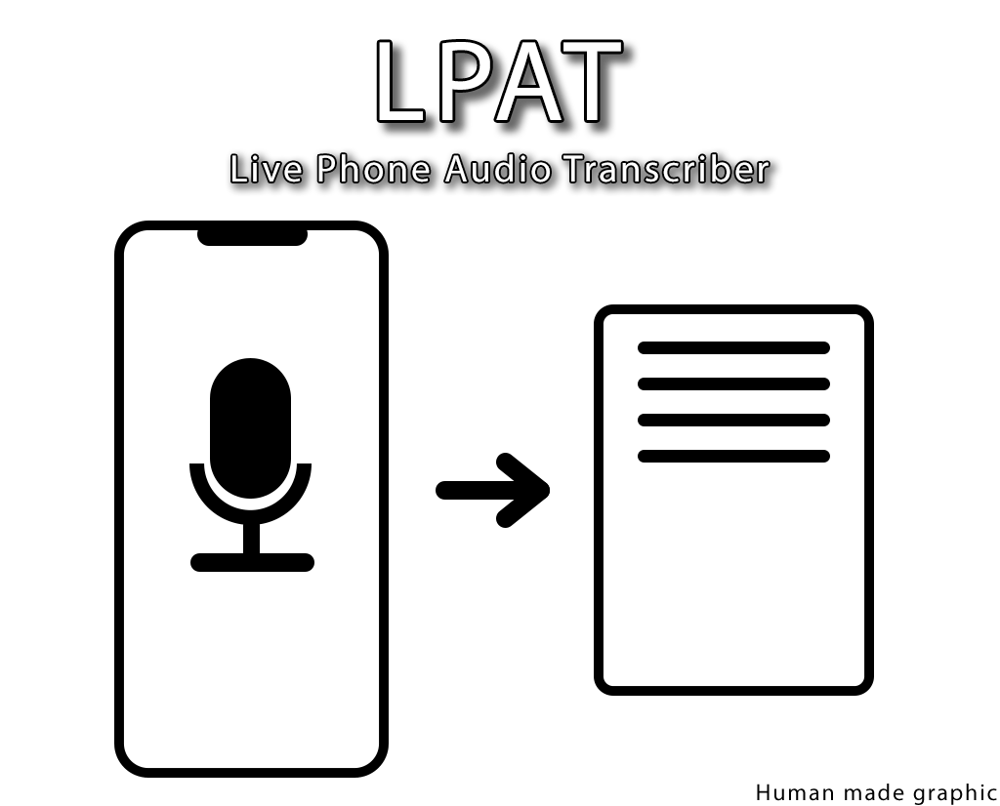

# Live Phone Audio Transcriber (LPAT)

Transcribe audio from a phone in the local network live, without installing any applications on the phone.

Please do not run LPAT without informing everyone present as most jurisdictions require you to get consent for recording from all parties being recorded.

## Running verification on examples
The verification examples are light to run and don't require
[Read more here](example-sessions/about.md)

## Running the server (Windows)
The default models take around 5 GB of disk space and require some VRAM so the server might not work on every computer.
- Run setup.py --full
- Run lpat.py

A QR-code will pop up on your screen allowing you to open it on your phone. You should be greeted by a fairly barebones website with a start and stop button.

Pressing start starts a session with the server, and you will start receiving a live transcript back from the server.

Pressing stop ends the session and the server will close the connection. You will find a session under sessions/ where there should be a transcript_final.jsonl, which was transcribed by the offline model.

You may wish to verify this session later on, more on verifying in [example sessions](example-sessions/about.md).

## Considerations & possible future improvements
- Anyone on the local network is able to start a session, this should be relatively simple to fix.
- Support for reconnecting to a session.